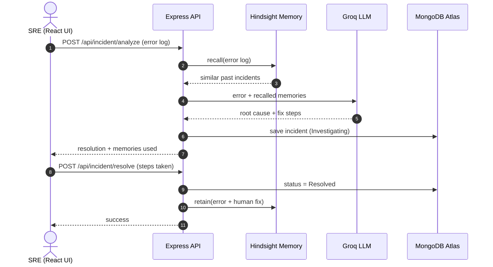

<div align="center">

# 🧠 OpsRecall

### The incident-response agent that remembers how *your* infrastructure broke before.


[The Problem](#-the-problem) · [Before vs After](#-before-vs-after) · [How It Works](#-how-it-works) · [How Hindsight Is Used](#-how-hindsight-memory-is-used) · [Setup](#-getting-started) · [API](#-api-reference)

</div>

---

## 🔥 The Problem

When production goes down, an SRE usually does the same thing: dig through old Slack threads, post-mortems and runbooks to find out *how a similar failure was fixed last time*.

A generic LLM doesn't help much here. Paste in a `502 Bad Gateway` and it will say "restart Nginx". It doesn't know your servers, your services, or the fix your team already found three weeks ago. And because it is stateless, it never learns.

## 💡 The Solution

**OpsRecall** is an AI agent with long-term memory built on **[Hindsight](https://github.com/vectorize-io/hindsight)**.

1. An engineer pastes a raw error log.
2. OpsRecall **recalls** semantically similar past incidents (root causes and fixes) from Hindsight.
3. A fast LLM (Groq) combines the new error with those memories to produce a fix specific to your infrastructure.
4. After the engineer resolves the issue, the steps they actually took are **retained** in memory, so the next outage is faster.

The agent gets better with every incident your team closes.

## 🎬 Before vs After

| | Memory OFF (generic assistant) | Memory ON (OpsRecall) |
|---|---|---|
| **Input** | `payments-api returned 502 Bad Gateway. upstream timed out` | *same error* |
| **Answer** | Generic checklist: check upstream, restart the web server, review the logs | Points to the matching past incident, names the likely cause (process hit its memory limit and was OOM-killed) and reuses the exact fix steps recorded for it |
| **Source of fix** | General model knowledge | Your team's own resolved incident |

> Illustrative example. Exact wording varies by model. Run it yourself with the **Use Memory** toggle in the UI.

**The learning loop:** analyze a brand-new error (generic answer) → resolve it with real steps → analyze a similar error again → the fix you just entered is now recalled.

## ⚙️ How It Works



## 🧠 How Hindsight Memory Is Used

Memory is the core of OpsRecall, not an add-on. Two calls drive the whole loop.

**Recall (before answering)** in `server/controllers/incidentController.js`:

```js
const recall = await hs.recall(BANK, log.slice(0, RECALL_QUERY_CHARS));
memories = recall.results.slice(0, TOP_K).map(r => r.text);
```

Hindsight searches by meaning, so an error worded differently from the old incident can still match. The top results are injected into the LLM prompt.

**Retain (after resolving)**:

```js
await hs.retain(BANK, `Incident: ${rawErrorLog}\nResolution by Engineer: ${feedback}`, {
  context: 'resolved incident',
  metadata: { type: 'resolved_incident', incidentId },
  async: false, // wait until processed so the next analyze can recall it
});
```

**Grounding the model** in `server/services/llm.js`: the system prompt tells the model to use only the recalled memories for company-specific details, to say so when no match exists, and never to invent server names or commands.

**Seed data:** `server/scripts/seed.js` preloads 8 realistic past incidents (OOM kills, Atlas IP allow-lists, Redis client exhaustion, Kubernetes config drift, S3 CORS, expired TLS certificates, Postgres connection slots, Elasticsearch disk watermarks), so the agent has institutional memory from the first run.

## 🧰 Tech Stack

| Layer | Technology |
|---|---|
| Frontend | React (Vite), Tailwind CSS |
| Backend | Node.js, Express 5 |
| Database | MongoDB Atlas (Mongoose) for incident state |
| **Agent memory** | **Hindsight Cloud** (`@vectorize-io/hindsight-client`) |
| LLM | Groq (`openai/gpt-oss-120b` by default, with automatic fallback to `openai/gpt-oss-20b`) |
| Dev tooling | Band AI desktop |

## 📁 Project Structure

```
OpsRecall/
├── client/                      # React frontend
└── server/
    ├── index.js                 # Express app + routes
    ├── models/Incident.js       # Mongoose schema
    ├── controllers/
    │   └── incidentController.js  # analyze (recall) + resolve (retain)
    ├── services/
    │   ├── memory.js            # Hindsight client + memory bank
    │   └── llm.js               # Groq client + system prompt
    └── scripts/
        ├── seed.js              # preload past incidents
        ├── test-api.js          # quick /analyze check
        └── test-resolve.js      # quick /resolve check
```

## 🚀 Getting Started

### Prerequisites

- Node.js 22.12+ (required by the installed Band SDK)
- A [MongoDB Atlas](https://www.mongodb.com/atlas) cluster (or local MongoDB)
- A [Hindsight Cloud](https://ui.hindsight.vectorize.io) account and API key
- A [Groq](https://groq.com) API key

### 1. Clone and install

```bash
git clone https://github.com/ompaul6767-ctrl/OpsRecall.git
cd OpsRecall

cd server && npm install
cd ../client && npm install
```

### 2. Configure environment

Create `server/.env` (this file is gitignored, never commit it):

```env
MONGO_URI=mongodb+srv://<user>:<password>@<cluster>.mongodb.net/opsrecall
HINDSIGHT_API_KEY=your_hindsight_key
GROQ_API_KEY=your_groq_key
PORT=5000

# Optional Band room notifications; leave both unset to disable
BAND_AGENT_API_KEY=
BAND_ROOM_ID=

# Optional
# Models are tried in order; if the first fails, the next is used
# GROQ_MODELS=openai/gpt-oss-120b,openai/gpt-oss-20b
# HINDSIGHT_BASE_URL=https://api.hindsight.vectorize.io
# HINDSIGHT_BANK_ID=opsrecall-infra
```

When both Band variables are set, OpsRecall posts an analysis summary and a
resolution status event to `BAND_ROOM_ID`. Notifications contain only the
incident ID, status, Hindsight recall count, and retention status; raw logs,
generated analysis, root-cause text, and engineer feedback are not sent. Band
delivery is best-effort and does not affect the incident API response.

### 3. Seed the memory (run once)

```bash
cd server
node scripts/seed.js --confirm
```

Running the seed more than once creates duplicate memories.

### 4. Run

```bash
# terminal 1: API on http://localhost:5000
cd server && node index.js

# terminal 2: UI (Vite default http://localhost:5173)
cd client && npm run dev
```

### 5. Smoke test the API

```bash
cd server
node scripts/test-api.js        # analyze with memory ON
# copy the incidentId from the output into scripts/test-resolve.js, then:
node scripts/test-resolve.js
```

## 📡 API Reference

Base URL: `http://localhost:5000`

### `POST /api/incident/analyze`

```jsonc
// request
{ "errorLog": "payments-api returned 502 Bad Gateway...", "useMemory": true }

// 200 response
{
  "incidentId": "665f...",
  "resolution": "1) Likely Root Cause ...",
  "memories": ["Incident: payments-api returned 502 ..."],
  "memoryEnabled": true,
  "memoryError": false
}
```

| Status | Meaning |
|---|---|
| 400 | `errorLog` missing or empty |
| 502 | LLM failed to generate a resolution |
| 500 | Unexpected server error |

If Hindsight is unreachable, the request still succeeds without memory and returns `memoryError: true`.

### `POST /api/incident/resolve`

```jsonc
// request
{ "incidentId": "665f...", "engineerFeedback": "Restarted via PM2, raised the memory limit..." }

// 200 response
{ "success": true, "retained": true, "message": "Incident resolved and retained in memory." }
```

| Status | Meaning |
|---|---|
| 400 | Invalid `incidentId` or empty `engineerFeedback` |
| 404 | Incident not found |
| 500 | Unexpected server error |

`retained: false` means MongoDB was updated but saving to Hindsight failed. An already-resolved incident returns `alreadyResolved: true` and is not retained twice.

## 🧪 Design Decisions

- **Memory toggle (`useMemory`)** makes the with/without-memory comparison reproducible.
- **Graceful degradation:** a Hindsight outage degrades to a generic answer instead of an error.
- **Grounded prompting:** the model is told to label generic advice as `GENERIC` and to state when no past incident matches.
- **Low temperature (0.2)** for consistent, factual output.
- **LLM fallback:** if the primary Groq model fails (rate limit, retired model), the next model in `GROQ_MODELS` is tried automatically.
- **Synchronous retain** (`async: false`) so a fix is recallable immediately after it is saved.

## ⚠️ Known Limitations

- Answer quality depends on the quality and specificity of the retained incidents.
- Recall returns the closest matches even when they are only loosely related, so the prompt tells the model to ignore irrelevant memories. Relevance is not scored in the UI yet.
- A single shared memory bank; there is no per-team or per-user isolation or authentication yet.
- Fallback models may phrase answers differently or be less accurate than the primary model.
- Seed data is synthetic. Replace it with your own post-mortems for real use.
- The `useMemory` switch is a demo and testing aid, not a production feature.

## 🗺️ Roadmap

- Authentication and per-team memory banks
- Importing existing post-mortems and runbooks in bulk
- Showing recall relevance in the UI
- Slack / PagerDuty integration to ingest alerts automatically

## 👥 Team

| Name | Role |
|---|---|
| Sarthak Gawande | Frontend (UI/UX) |
| Sujal Khandre | Backend and database |
| Om Paul | AI logic and memory engineering |
| Ved Kale | Demo, docs and product |

## 🔗 Links

- Hindsight on GitHub: https://github.com/vectorize-io/hindsight
- Hindsight documentation: https://hindsight.vectorize.io/
- What is agent memory: https://vectorize.io/what-is-agent-memory
- Live demo: _add URL_
- Demo video: _add YouTube URL_

---

<div align="center">
Built with Hindsight agent memory. Every resolved incident makes the next one faster.
</div>